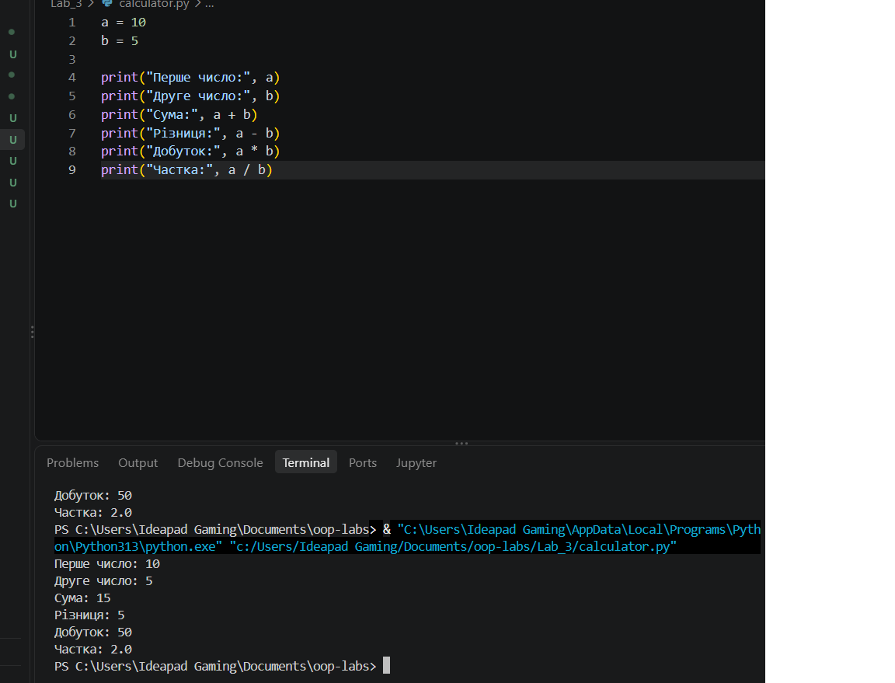

# Практична робота: Markdown

## Мета роботи

Навчитися використовувати Markdown для оформлення тексту у GitHub.

### Форматування тексту

Звичайний текст.

Жирний текст

*Курсивний текст*

Закреслений текст

Фрагмент коду

> Приклад цитати в Markdown.

---

## Нумерований список

1. Створити репозиторій GitHub.
2. Відкрити репозиторій у Visual Studio Code.
3. Створити файл README.md.
4. Відредагувати текст у Markdown.
5. Зберегти зміни та виконати Commit.

## Маркований список

- GitHub
- Visual Studio Code
- Markdown
- Python

## Таблиця робіт

| № | Назва роботи | Статус |
|---|---|---|
| 1 | Створення репозиторію | Виконується |
| 2 | Основи Markdown | Виконується |
| 3 | Перша програма на Python | Виконано |

## Корисні посилання

- [GitHub](https://github.com/)
- [Документація Markdown](https://code.visualstudio.com/docs/languages/markdown)
- [Головний README](../README.md)
- [README роботи з Python](../Lab_3/README.md)

## Приклад коду

name = "Liubomyr"
print("Hello,", name)
## Зображення

Результат роботи калькулятора:

## Висновок

Я ознайомився з основними можливостями Markdown: заголовками, форматуванням тексту, списками, таблицями, посиланнями та зображеннями.